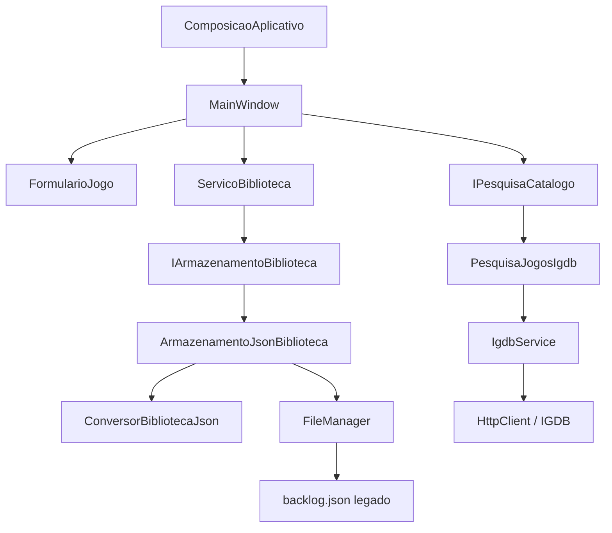

# Arquitetura após a Fase 1

## Objetivo e limites

A Fase 1 separa a apresentação, os dados do catálogo, os registros pessoais, a pesquisa e o armazenamento. A interface continua sendo a aplicação Avalonia existente de jogos. As seis mídias estão representadas apenas nos modelos; suas telas, cadastros e serviços simulados pertencem à Fase 2. Nenhuma API nova ou armazenamento remoto foi implementado.

O aplicativo continua em um único projeto executável, com um projeto de testes. Não foram introduzidos contêiner de injeção de dependências, MVVM, projetos por camada ou novas dependências de produção.

## Fluxo das dependências

As setas que saem dos contratos indicam a implementação local escolhida pela composição. Outras implementações poderão satisfazer esses contratos no futuro, sem serem criadas nesta fase.

## Responsabilidades

| Componente | Responsabilidade |
|---|---|
| `MainWindow.axaml` | Mantém o layout e liga textos aos modelos separados, como `Catalogo.Titulo` e `Pessoal.Nota`. |
| `MainWindow.axaml.cs` | Lê controles, apresenta avisos, controla seleção/navegação e o ciclo de vida das buscas. Delega operações da biblioteca e preparação do formulário. |
| `ComposicaoAplicativo` | Monta os objetos concretos, lê configuração local e define quem é responsável pelo cliente HTTP. |
| `FormularioJogo` | Valida o formulário e prepara um novo item ou uma edição somente dos dados pessoais. |
| `ServicoBiblioteca` | Carrega, cadastra, edita, remove, filtra e calcula os mesmos resumos/recentes existentes. Confirma a memória somente depois de persistir. |
| `IArmazenamentoBiblioteca` | Define as operações de carregamento/gravação usadas pelo serviço, sem expor `FileManager`. |
| `ArmazenamentoJsonBiblioteca` | Adapta os modelos novos para o formato JSON atual e reaproveita as proteções de disco da Fase 0. |
| `ConversorBibliotecaJson` | Concentra a conversão para/de `BacklogItem`, incluindo identificadores e propriedades desconhecidas. |
| `FileManager` | Continua responsável por leitura/gravação, validação do formato legado, hash, bloqueio, temporário e `.bak`. Sua implementação foi preservada nesta fase. |
| `IPesquisaCatalogo` | Define pesquisa assíncrona com cancelamento, retornando somente obras de catálogo. |
| `PesquisaJogosIgdb` | Converte os resultados IGDB para o modelo comum, sem acrescentar informações pessoais ou inventar capas/gêneros. |
| `IgdbService` | Continua responsável pelo protocolo HTTP/APICalypse, autenticação, desserialização e falhas IGDB da Fase 0. Sua implementação foi preservada. |

## Modelos e compatibilidade

### ObraCatalogo

Contém título, tipo de mídia, origem/identificador externo e campos preparados para referência de capa e gêneros. Não contém nota, status ou review pessoal.

`TipoMidia` possui `Jogo`, `Anime`, `Serie`, `Filme`, `Manga` e `Livro`. Declarar esses valores não ativa funcionalidades na interface nem faz requisições HTTP para essas mídias.

Uma seleção IGDB é representada por `Tipo = Jogo`, `Origem = "IGDB"` e `IdentificadorExterno` com o ID numérico em texto decimal. O serviço HTTP original ainda usa `IgdbGame` como resposta da API; o adaptador isola esse detalhe.

### DadosPessoaisBiblioteca

Agrupa categoria escolhida pelo usuário, status, nota e review. A categoria pessoal antiga permanece pessoal; ela não é reinterpretada como gênero oficial de catálogo. Status antigos continuam strings, sem migração para enums.

### ItemBiblioteca

Relaciona uma obra de catálogo a seus dados pessoais. Também preserva explicitamente `SteamAppIdLegado` e propriedades JSON desconhecidas. Esses metadados transitórios de compatibilidade não identificam a obra no catálogo.

A edição pelo serviço recebe somente `DadosPessoaisBiblioteca`. O catálogo e os metadados do item original são mantidos. Isso reduz o risco de uma edição de nota mudar a referência externa do jogo.

### BacklogItem

Permanece como registro do formato JSON legado. O arquivo continua sendo uma lista de objetos com `Titulo`, `Categoria`, `Status`, `Nota`, `Review`, `SteamAppId` e `IgdbId` opcional. A interface usa `ItemBiblioteca`.

Nenhum envelope, versão de formato ou migração foi acrescentado. O adaptador faz a conversão em memória, preservando o caminho e os valores atuais. Propriedades desconhecidas são copiadas, inclusive seus valores JSON aninhados; a cópia evita compartilhar um dicionário mutável com o registro convertido.

**Proteção contra perda de dados futuros:** o modelo comum pode representar outras mídias, provedores, capas e gêneros, mas o formato atual ainda não os comporta. O adaptador local recusa esses dados antes de gravar o lote inteiro. A futura evolução do formato precisará de planejamento, backup e validação próprios. Nesta fase não há suporte funcional de biblioteca para essas mídias.

## Operações e falhas

1. A composição prepara armazenamento, serviço da biblioteca e pesquisa opcional.
2. A janela solicita ao serviço o carregamento. Falha de leitura mantém gravações bloqueadas.
3. O formulário prepara um item validado, sem gravar ou alterar controles.
4. O serviço cria uma lista candidata e solicita a persistência.
5. Após o retorno bem-sucedido do armazenamento, o serviço confirma a nova lista em memória.
6. A janela atualiza seus controles e apresenta sucesso. Em falha, mantém o estado anterior e o formulário.

O serviço usa a instância selecionada para localizar o registro; IDs externos ou títulos repetidos não provocam deduplicação. `record` compara valores, e duas cópias pessoais podem ter valores idênticos. Por isso a janela restaura a seleção pelo índice da mesma instância após filtrar; atribuir apenas `SelectedItem` podia selecionar a primeira cópia igual.

A espera de 400 ms, o cancelamento HTTP e a rejeição de respostas antigas permanecem no fluxo da janela. A pesquisa por contrato continua retornando `Task` e recebendo `CancellationToken`.

## Conceitos C# introduzidos

- **Interface:** uma lista pequena de operações que outro objeto deve oferecer. O serviço recebe `IArmazenamentoBiblioteca`; o armazenamento JSON e o armazenamento em memória dos testes seguem essa mesma lista.
- **Injeção pelo construtor:** as dependências são entregues ao objeto quando ele é criado. Não exige uma biblioteca de injeção. A janela deixa de escolher o arquivo e o cliente HTTP por conta própria.
- **Adaptador:** traduz o formato de um componente para outro. `PesquisaJogosIgdb` traduz a resposta específica da IGDB; `ArmazenamentoJsonBiblioteca` traduz o modelo comum para a persistência atual.
- **Registro de transporte:** `BacklogItem` descreve o formato existente no disco. A forma do arquivo não precisa ser a mesma organização das classes usadas pela aplicação.
- **`record`, `init` e `with`:** propriedades são inicializadas na criação, e `with` prepara uma cópia com os dados alterados. Essa escolha evita modificar o item original antes de saber se a gravação funcionou. Coleções referenciadas não se tornam profundamente imutáveis automaticamente.
- **`IReadOnlyList`:** permite consultar a lista; as operações de cadastro/edição/remoção ficam no serviço, que confirma a persistência. O serviço protege sua lista com uma coleção somente leitura.

## Composição e propriedade dos recursos

A composição cria um cliente HTTP por janela quando a configuração é válida, com timeout de 15 segundos e renovação de conexões após cinco minutos. Sem credenciais, a biblioteca local continua disponível.

`IGDB_ACCESS_TOKEN` não vazio tem precedência, com compatibilidade preservada para `IGDB_ACESS_TOKEN`. Credenciais continuam nas variáveis locais. O cliente não é criado enquanto a configuração for inválida ou ausente.

A janela recebe o recurso HTTP próprio separadamente e o descarta ao fechar. Uma pesquisa recebida de outro chamador, sem transferência desse recurso, não é descartada pela janela. Isso é verificado nos testes para evitar fechar recursos compartilhados indevidamente.

## Decisões para evolução gradual

- O contrato de armazenamento permanece síncrono, acompanhando o uso local atual. Uma futura integração remota deverá avaliar operações assíncronas e conflitos; esta fase não promete implementação pronta de nuvem ou sincronização.
- A busca já é assíncrona porque usa rede. Não foram criados provedores falsos de outras mídias na aplicação. As simulações desta fase ficam somente nos testes.
- A seleção e os avisos permanecem na janela. Migrar toda a apresentação para MVVM não foi necessário para cumprir esta fase.
- `JsonElement` permanece apenas nos metadados de compatibilidade de `ItemBiblioteca` e nos registros/adaptadores JSON. Essa concessão explícita evita perder campos antigos durante a transição; os dados de catálogo e pessoais não dependem dele.
- Preferências, exportação/importação de backup, autenticação remota e sincronização continuam reservadas às fases do contrato. O `.bak` de proteção da Fase 0 permanece no componente de persistência.

## Testabilidade

A suíte mantém os cenários anteriores e acrescenta grupos específicos para conversão, armazenamento, carregamento, cadastro, edição, remoção, consultas, formulário, pesquisa, composição e integração da janela. Cada grupo possui ao menos dez cenários relevantes.

`ArmazenamentoSimulado` e pesquisas simuladas satisfazem os contratos apenas no projeto de testes. A interface é exercitada com Avalonia Headless/Skia, arquivos temporários e HTTP simulado. Nenhum teste da suíte usa a biblioteca pessoal real. A verificação adicional de compatibilidade usa uma cópia isolada e confirma o hash do original antes e depois.
